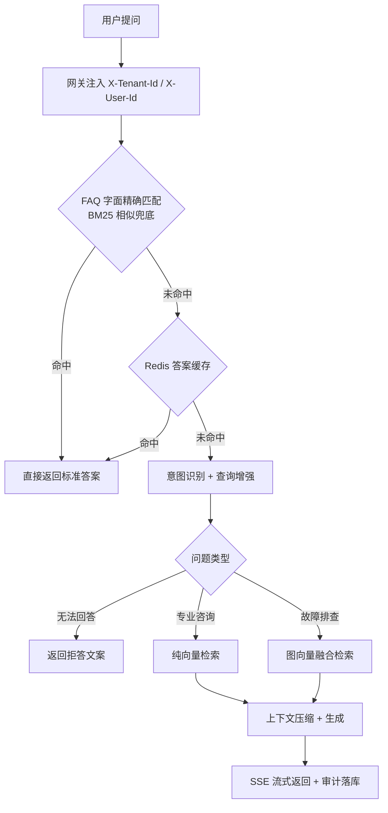
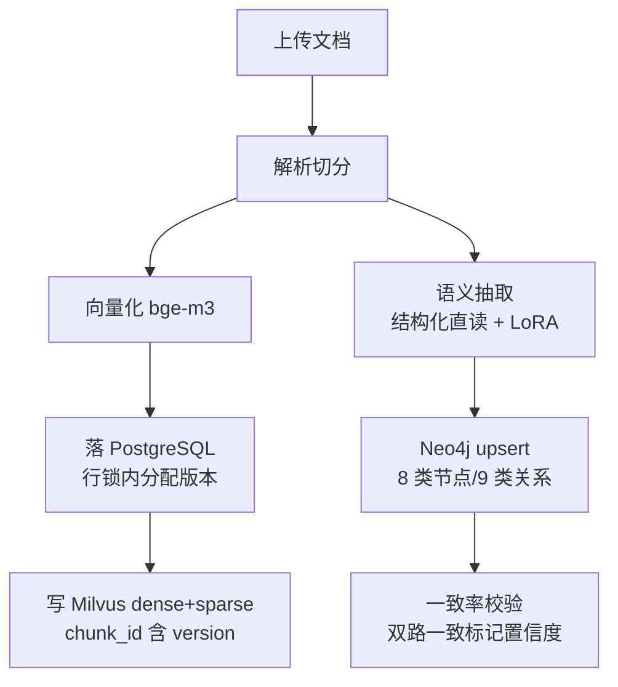
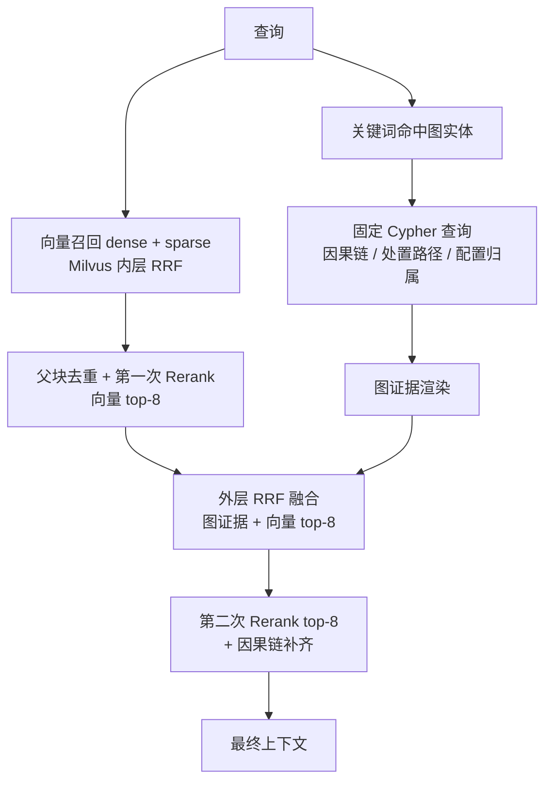
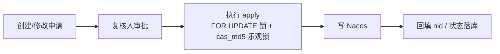

# RAG-Ultra：面向运维故障的 GraphRAG 问答服务

多租户故障问答中台。以故障知识图谱为扩展证据来源，向量 RAG 为底座：命中图路时把实体、因果关系和处置路径送进上下文，图路不可用时退回纯向量链路。

- **图谱主线**：8 类节点、9 类关系，结构化直读 + LoRA 语义抽取双路线建图
- **检索底座**：Milvus dense+sparse 混合召回 → 父块去重 → Rerank → 图向量融合 → 二次精排
- **工程规模**：FastAPI + LangChain + PG + Neo4j + Milvus + Redis + Nacos，约 210 个源文件，300+ 单测

## 1. 目录结构

```
.
├── app/                 # 接入层：FastAPI 路由、Manager、中间件、应用装配
│   ├── api/             # user/dashboard 路由 + Pydantic 契约 + 统一异常
│   ├── managers/        # 组件生命周期：Redis/PG/Milvus/Neo4j/模型/索引/图构建
│   └── middleware.py    # HMAC 签名 / Trace / 访问日志 / CORS
├── core/                # 业务内核
│   ├── graph/           # 故障图谱：Schema、Cypher 模板、LoRA 抽取、图向量融合
│   ├── rag_retriever/   # 检索编排：父子块去重、RRF 融合、Rerank 重排
│   ├── rag_indexer/     # 切分 + 向量化 + 落库 + 版本管理
│   ├── rag_generator/   # 提示词装配、LLM 生成与流式输出
│   ├── qa_router/       # 问答路由：FAQ / 缓存 / 图RAG / 空召回分流
│   ├── config_center/   # Nacos 配置热更新 + 审批流
│   └── auth/            # HMAC 签名与身份头
├── store/               # PG/Redis/Milvus/Neo4j DAO、ORM 模型、Redis key 约定
├── offline/             # 离线脚本：图构建、LoRA 训练/评测、RAGAS 评测
├── scripts/             # 正式工具链：DDL 生成、DDL 基准、签名头生成
├── tests/               # pytest + mock 单测，镜像正式包结构
└── docker/              # 中间件 compose 与部署配置
```

## 2. 核心链路

### 2.1 在线问答（四路分流）



四路对应 `source` 字段：`faq` / `cache` / `graph_fused` / `rag`，审计表逐轮记录命中来源与耗时。

### 2.2 离线索引（向量与图分叉）



两条路径共用切分结果，但失败互不影响：向量写失败回写索引状态，图建失败只告警。文档版本用 `Doc` 行锁串行分配，重复索引不会写脏版本。

### 2.3 图向量融合检索（两次 Rerank）



两层 RRF 的原因：内层融合向量的 dense/sparse 两路打分；外层融合图证据与向量候选——图证据没有可比的相似度分，用排名融合比编造加权分更可靠。图路超时或空结果自动退回纯向量 top-8。

## 3. 故障知识图谱

图谱是本项目的主线，不是向量检索的附属标签。

**建图双路线**：

- **结构化直读**：从故障复盘文本中按固定模式抽取单号、时间、影响范围、根因分类
- **LoRA 语义抽取**：`bge-m3` + LoRA 微调模型输出实体与关系，guided_json 约束解码保证结构合法；3 次采样的一致率作为置信度，低一致结果需人工复核

**在线查询**：3 条固定 Cypher 覆盖因果链、处置路径、配置归属三类问法；图证据与向量候选按 RRF 融合后二次精排，避免图路结果压过真实文本证据。

**租户隔离**：Neo4j 每个节点带 `tenant_id` 属性，Cypher 查询强制过滤。

## 4. 多租户与安全

- 租户身份来自网关头 `X-Tenant-Id`，业务层不再从 query 参数读取
- 隔离分四层：Milvus partition key、Redis key 前缀、PG 行 `tenant_id`、Neo4j 节点属性
- HMAC 签名中间件校验时间戳 + nonce 防重放；`AUTH_HMAC_FAIL_CLOSED=True` 时依赖故障直接拒绝，不静默降级
- 会话按 `user_id` 隔离（网关保证全局唯一），`tenant_id` 仅作审计统计

## 5. 配置中心与审批流

Nacos 配置热更新，写操作走审批：



读写分离：普通读走内存缓存 + Nacos 实时监听；写走审批流保证变更可追溯。执行失败显式回滚状态，Nacos 异步可见问题由 `sync_history_nids` 补偿。

## 6. 评测与实验

- `offline/rag_eval.py`：RAGAS 离线评测，生成问答对后跑 faithfulness / answer_relevancy 等指标
- `train/`：LoRA 抽取模型的训练与评测数据、脚本、指标说明

训练数据是模板化合成构造，指标只能解释为"模板内抽取能力"，不外推到真实故障。README `train/README.md` 记录了两处已知方法学缺陷（场景泄漏、标注不可溯源）和对应的审计脚本，便于复核。

## 7. 技术栈

| 层 | 选型 |
|---|---|
| API | FastAPI + Pydantic + SSE |
| 任务 | asyncio + Redis BRPOP 队列 + Manager 分阶段启停 |
| 存储 | PostgreSQL 16、Redis 7、Milvus 2.5、Neo4j 5、MinIO |
| 模型 | bge-m3（稠密/稀疏）、bge-reranker-v2-m3、Qwen（OpenAI 兼容网关） |
| 配置 | Nacos + pydantic-settings + .env 覆盖 |
| 测试 | pytest + unittest.mock |

## 8. 运行

### 8.1 启动中间件

```bash
cd docker
docker compose up -d
```

compose 包含 PostgreSQL 16、Redis 7（带密码）、Milvus 2.5、Neo4j 5、MinIO、Attu。默认密码见 `.env.example`，生产部署请替换。

### 8.2 初始化数据库

```bash
docker exec -i postgres-server psql -U postgres -d rag_ultra < scripts/schema_postgresql.sql
```

### 8.3 准备模型权重

模型放在 `models/` 下（已 gitignore），路径对应 `common/config.py`：

```
models/
├── BAAI/bge-m3/                    # 稠密 + 稀疏向量
├── BAAI/bge-reranker-v2-m3/        # 精排
└── bert-intent-recognition-model/  # 意图分类
```

从 Hugging Face 下载后放到对应目录；意图分类模型缺失时服务降级但不阻断启动。

### 8.4 配置环境变量

```bash
cp .env.example .env
# 按需修改数据库地址、密码、LLM 网关地址等
```

### 8.5 启动服务

```bash
python run.py           # 生产模式（uvicorn workers）
python run.py --reload  # 开发模式（单 worker 自动重载）
```

服务启动后 `GET /admin/health` 可查看各依赖组件的连通状态。

### 8.6 签名头生成

启用 `AUTH_HMAC_ENABLED=True` 后，调用方需带签名头。生成方式：

```bash
python scripts/gen_auth_headers.py --method POST --path /v1/chat --tenant 100 --user test --base-url http://127.0.0.1:8000
```

脚本输出 `X-Trace-Id` / `X-Signature` / `X-Timestamp` 及身份头，供接口调试使用。
