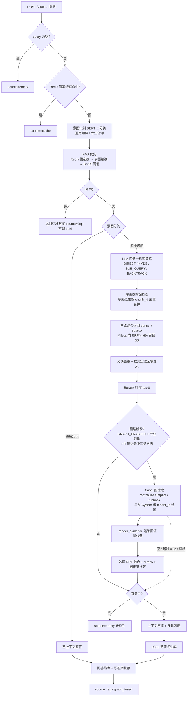
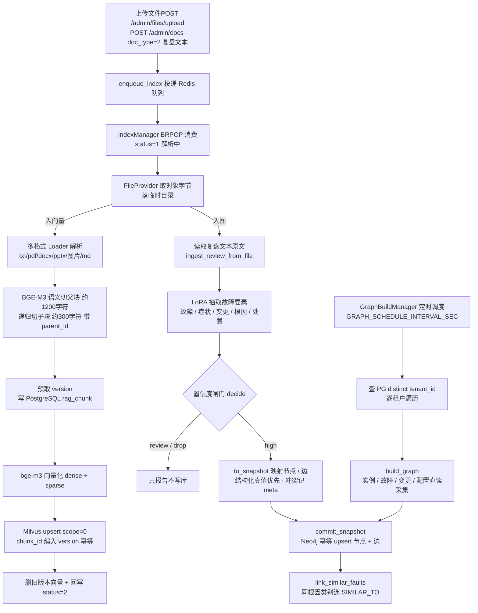
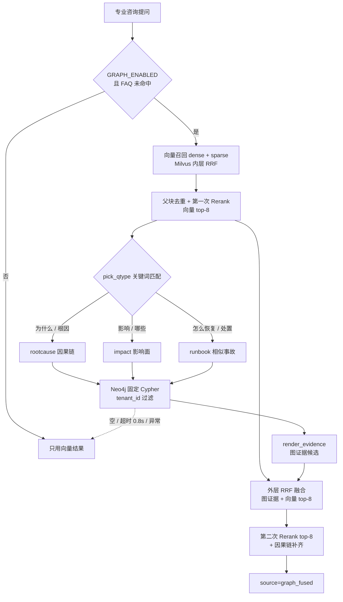

# 面向多租户系统故障的问答中台（GraphRAG）

本项目在 RAG 问答链路之外新增一层故障知识图谱，原有问答链路保持不变。运维排查故障时，根因、影响面、处置这类问题的答案分散在变更记录、组件状态和事故复盘里——一条因果链跨多跳，任何单篇文档只有其中一跳，向量检索拼不出因果和先后，答案在**实体之间的边上**。项目用"结构化直读 + LoRA 语义抽取"双路线建图，问答时把图证据与向量候选融合，让这类问题能带证据链回答。

用户提问后：答案缓存与 FAQ 先挡掉高频问题；专业咨询走意图分流与查询增强；检索阶段图路和向量路并行召回，外层 RRF 融合后统一 rerank 精排、按因果链补齐证据，最后流式生成并标注来源。图路超时或异常自动退回纯向量，用户无感。

技术栈：Python + FastAPI + PostgreSQL + Milvus + Redis + Neo4j + Nacos + MCP；检索 bge-m3（dense + sparse）、精排 bge-reranker-v2-m3、意图分类 bert-base-chinese；故障要素抽取用 Qwen2.5-1.5B + LLaMA-Factory LoRA，vLLM 配 guided_json 受限解码。

---

## 1. 能力概览

- **故障图谱**：8 类节点、9 类关系的故障图谱，三条 Cypher 覆盖因果链 / 影响面 / 相似事故；图证据与向量候选做外层 RRF 融合，结果标注 `graph_fused`，超时或空命中退回纯向量。
- **双路线建图**：结构化侧直读 API 日志、连接池状态、Nacos 实例等精确值；语义侧用 LoRA 从复盘抽取故障要素。同一文本 3 次采样取字段一致率当置信度，低置信进人工队列，结构化与模型冲突时以结构化为准。
- **自动入图**：上传复盘文本（`doc_type=2`）索引完成后自动抽取入图；结构化数据由 `GraphBuildManager` 定时重建，两条路径共用幂等写入并补相似事故边。
- **底座问答链**：答案缓存 + FAQ 优先（字面精确 + BM25 阈值）零推理成本；bge-m3 混合召回、Milvus 内 RRF、bge-reranker 精排；父子块切分与定位高亮。
- **查询增强**：LLM 四选一（DIRECT / HYDE / SUB_QUERY / BACKTRACK），失败回退 DIRECT。
- **四层隔离**：Milvus partition key、Redis key 前缀、PostgreSQL `tenant_id`、Neo4j 节点 `tenant_id`；图建边强制校验两端租户一致，零跨租户连边。
- **配置与审计**：提示词、检索阈值托管 Nacos，写操作走申请→复核→执行→回滚；请求链有 trace、API 日志落库、问答明细异步持久化。

---

## 2. 核心链路

### 2.1 在线问答（检索 → 生成）



`source` 取值：`cache` / `faq` / `rag` / `graph_fused` / `empty`。`answer` 与 `answer_stream`（SSE）共用这条链路；`meta` 事件携带 `source`、`intent`、`session_id`、`chunks`、`compress`。

### 2.2 离线索引（数据录入：入向量 + 入图）



上图以 `doc_type=2`（故障复盘文本）为例：同一份文件从取字节处分叉，入向量与入图两条路径互不依赖、失败互不影响；代码里虽在同一 job 中先后调用，但无因果先后关系。`doc_type=0/1` 只走上面那条入向量链（1 的 scope=1）。

- 文档向量链：状态机 `0 待解析 → 1 解析中 → 2 完成 / 3 失败`；Redis 不可用降级进程内异步任务，`IndexManager` 启动重扫 `status=0` 残留入队。
- 上传即入图：`doc_type=2` 入图在独立 try 中调 `ingest_review`，失败只告警、不改已完成的索引状态。LoRA 抽取经置信度闸门，只有 `high` 才写 Neo4j。
- 定时建图：`GraphBuildManager`（stage 3）每轮从 PG 查有数据的租户，逐个跑 `build_graph` 直读采集 PostgreSQL / Nacos 资产并幂等入图；Nacos 依赖长生命周期复用。`GRAPH_SCHEDULE_ENABLED` 控制开关，默认周期 3600 秒。
- 两条入图路径共用 `commit_snapshot` 幂等写入，并补 `SIMILAR_TO` 边供 runbook 查询召回。
- 版本治理：重新索引旧版本 `enabled=0` 软删，`chunk_id` 编入 version 保证主键不冲突；回滚切换 PG 启用版本并重写 Milvus 实体（先增后删，避免检索空窗）。
- FAQ 旁路：`POST /admin/faq` 写 PostgreSQL 并重载 Redis 候选表缓存，命中走字面精确 + BM25，不查 Milvus。

### 2.3 GraphRAG 图路融合



图证据与向量 chunk 不在同一 id 空间，融合按 `(doc_name, chunk_id, 内容前 32 字)` 去重，只用排名（RRF），不编造跨模态相似度。图查询超时或异常一律退回纯向量，`source` 仍为 `rag`。

---

## 3. 模块与目录

| 模块 | 路径 | 职责 |
|---|---|---|
| 接入层 | `app/api`、`app/main.py`、`app/server.py`、`app/app_factory.py` | 路由 / 鉴权 / 多租户 / trace / 统一响应 / Manager 编排 |
| 索引 | `core/rag_indexer` | 取字节 → 父子块切分 → 写库 → 向量化 → Milvus upsert；复盘文本（doc_type=2）附加入图 |
| 检索 | `core/rag_retriever` | 四策略增强 + 混合召回 + RRF + Rerank + 父块去重 |
| 生成 | `core/rag_generator` | LCEL 组装上下文 → 流式生成 |
| 路由 | `core/qa_router` | 缓存 → 意图 → FAQ 优先 → 图路 → RAG 兜底 |
| 故障图谱 | `core/graph` | 要素抽取 / 入图 / 图检索 / 图向量融合 |
| 意图 | `core/intent` | BERT 二分类推理（训练离线在 `scripts`） |
| 模型 | `core/rag_model` | bge-m3 dense+sparse / bge-reranker 封装 |
| 存储 | `store` | PostgreSQL / Milvus / Redis / Neo4j |
| 配置中心 | `core/config_center` | Nacos 配置客户端与审批流 |
| 文件 | `core/file_provider` | MinIO 文件提供者 |
| 评测 | `offline/rag_eval.py` | RAGAS 离线评测（库内取数 / 标注文件） |

```text
RAG-Ultra/
├── app/
│   ├── main.py / run.py / app_factory.py / server.py / app_state.py / middleware.py
│   ├── managers/            # Logging/Redis/PostgreSQL/Model/FileProvider/
│   │                        # Milvus/FaqCache/Neo4j/GraphBuild/NacosConfig/NacosDiscover/
│   │                        # Index/MCPApi
│   └── api/
│       ├── deps.py schemas/ exceptions.py
│       ├── user/            # qa / session
│       └── dashboard/       # health/doc/faq/file/config_read/config_write/retrieve/graph
├── core/
│   ├── rag_indexer/ rag_retriever/ rag_model/ rag_generator/ qa_router/
│   ├── graph/               # 故障图谱：router/query/fusion/render/schema/ingest/extractor_lora
│   ├── intent/ config_center/ auth/ file_provider/ session/ session_memory/ utils/
├── store/
│   ├── orm_models/          # PostgreSQL ORM
│   ├── postgres_store.py milvus_store.py neo4j_store.py redis_store.py
│   ├── faq_cache.py *_dao.py redis_keys.py
├── common/                  # config.py / logger.py / response.py
├── offline/                 # RAGAS 评测
├── scripts/                 # schema / 鉴权头生成 / chunk_id 回填 / 意图训练
├── docker/ tests/ docs/
├── models/                  # 模型权重（gitignore）
├── requirements.txt
└── README.md
```

---

## 4. 检索与生成

- **检索策略**：`StrategySelector` 用 LLM 零样本分类选 DIRECT / HYDE / SUB_QUERY / BACKTRACK；`QueryAugmenter` 生成假设文档、子查询（最多 3）或回溯问题，按 `chunk_id` 去重合并，增强为空自动回退 DIRECT。
- **混合召回**：bge-m3 同一次推理产出 dense（L2 归一化后走 IP，等价余弦）与 sparse；按 `tenant_id` + `scope` 过滤，`doc_ids` / `ref_ids` 可下推；Milvus 内 `RRFRanker(k=60)`，可切 `WeightedRanker(0.7/0.3)`。
- **父块处理**：同 `parent_id` 只返回父块，命中子块在父块文本中用 `<检索定位区块>` 标签包裹，生成时提示模型聚焦该段。
- **精排**：`bge-reranker-v2-m3` 精排至 top-8，异常退回 RRF 前 top_k。
- **上下文压缩**：累计超阈值按分数截取（truncate / select / summary 三档），按句截断保留溯源，异常回退原样；`meta.compress` 返回实际压缩方式与丢弃数。
- **生成**：`RunnableParallel → PromptTemplate → ChatOpenAI(streaming) → StrOutputParser`，提示词来自 Nacos（不可达用内置兜底），结果逐 token 通过 SSE 输出。

---

## 5. 数据接入与存储

### 5.1 文档 / FAQ 入库

- 文档：上传对象存储得 `oss_key` → 建索引记录 → 异步入队 → 解析切分 → PG 落 `rag_chunk` → Milvus 双向量 upsert → 状态回写。支持幂等上传、多版本与回滚。
- FAQ：后台新建 → `FaqDao` 写 PostgreSQL → 重载 Redis 单条键与租户候选表；删除为软删（`enabled=0`）。
- 文件存储走 MinIO，`FileProvider` 抽象按后缀选 Loader，未知后缀回退 UTF-8 文本加载。

### 5.2 存储层

| 存储 | 内容 | 关键设计 |
|---|---|---|
| PostgreSQL | 租户 / 文档 / FAQ / 会话 / 问答明细 / API 日志 / 配置审批 | 异步 SQLAlchemy（`asyncpg`），`tenant_id` 隔离 |
| Milvus | 文档与 FAQ 向量 | `rag_chunks` 集合，dense HNSW(IP) + sparse `SPARSE_INVERTED_INDEX`(IP)，`tenant_id` partition key |
| Redis | 答案 / prompt / embedding / FAQ 缓存、会话原文与记忆、停止标记、签名 nonce、限流 | key 前缀与 TTL 集中在 `store/redis_keys.py` |
| Neo4j | 故障图谱节点与关系 | `id` 唯一约束保证 upsert 幂等，`tenant_id` 索引支撑隔离查询 |

---

## 6. 多租户与接入

**中间件链**（外→内）：`CORS → Trace → ApiLog → Auth → 路由`。Auth 置于最内层，验签失败仍由 Trace / ApiLog 记录。

- **身份**：`X-Tenant-Id`（整数）+ `X-User-Id` 经 `resolve_tenant` 写入 contextvars。网关未接入时可用默认租户兜底；接入后缺头即拒（401）。
- **签名**：`HMAC-SHA256(secret, METHOD\nPATH\nTIMESTAMP\nNONCE\nTENANT\nUSER)`，校验时间窗（±60s）与 Redis `SETNX` nonce 去重防重放；轮换期支持新旧密钥任一通过。`scripts/gen_auth_headers.py` 可生成联调用签名头。
- **统一响应**：`{"code": 0, "msg": "", "data": {}}`；`40001` 缺租户、`40100` 未授权。

---

## 7. API

**用户侧**（`/v1`）：`POST /v1/chat`（SSE 问答）、`POST /v1/chat/stop`（跨 worker 停止生成）、`DELETE /v1/chat/context/{session_id}`（清窗口记忆）、`/v1/sessions` 系列（建会话 / 列表 / 详情 / 标题 / 删除 / 追加轮次）。

**运营后台**（`/admin`）：
- 健康 `/admin/health`；检索调试 `/admin/retrieve`
- 文件：`/admin/files` 上传 / 批量 / 列表 / 版本 / 下载 / 删除
- 文档：`POST /admin/docs`、`GET /admin/docs/{id}/status`、`GET /admin/docs/{id}/versions`、`POST /admin/docs/{id}/rollback`
- FAQ：`/admin/faq` 增 / 删 / 改 / 查 / 列表
- 配置中心：`/admin/config` 命名空间 / 列表 / 详情 / 历史 / 变更申请 / 复核 / 执行 / 回滚
- 图调试：`GET /admin/graph/query`（直查图证据）、`GET /admin/graph/stats`（节点与关系统计）

`/admin/health` 返回 8 项组件状态：`redis / postgres / milvus / model / mcp / nacos / config_center / graph`。

---

## 8. 工程能力

- **Nacos**：服务发现（注册 `SERVICE_NAME@IP:PORT`，`NACOS_DISCOVER_STRICT` 控制失败是否阻断启动）与配置中心（独立命名空间，v3 OpenAPI 读 / 发布 / 回滚；回滚按 `nid` 取历史内容重发）。
- **配置审批流**：写操作经申请 → 复核 → 执行 → 回滚，历史审计复用 Nacos `his_config_info`，审批表自建于 PostgreSQL。
- **MCP**：`MCPApiManager` 把全部 HTTP API 自动封装为 MCP 工具，`streamable-http` 协议，`127.0.0.1:8766`；工具经进程内 ASGI 调用，复用同一套中间件。
- **日志与审计**：trace id 请求级透传并回写响应头；API 日志落 `rag_api_call_log`（敏感头脱敏）；问答明细异步写 `rag_turn` 与 Redis 会话，记录 `source` / `strategy` / `chunks` / 压缩统计 / 延迟。

---

## 9. 运行与配置

```bash
# 中间件
docker compose -f docker/docker-compose.yml up -d
createdb -h127.0.0.1 -U postgres rag_ultra
psql -h127.0.0.1 -U postgres -d rag_ultra -f scripts/schema_postgresql.sql

# 依赖与模型
pip install -r requirements.txt
# bge-m3 / bge-reranker-v2-m3 权重放 models/BAAI/ 下

# 启动
python -m app.main   # 开发：单 worker
python run.py        # 生产：uvicorn 多 worker（WORKERS）
```

| 分组 | 配置项 | 默认 |
|---|---|---|
| 服务 | `HOST` / `PORT` / `WORKERS` | `127.0.0.1` / `8800` / `1` |
| 检索 | `RECALL_K` / `RERANK_TOP_K` / `RRF_K` / `SUBQUERY_MAX` | `50` / `8` / `60` / `3` |
| 融合 | `DENSE_WEIGHT` / `SPARSE_WEIGHT` | `0.7` / `0.3` |
| FAQ | `FAQ_BM25_ENABLED` / `FAQ_BM25_THRESHOLD` | `True` / `2.0` |
| 图路 | `GRAPH_ENABLED` / `GRAPH_MAX_EVIDENCE` / `GRAPH_QUERY_TIMEOUT` | `True` / `24` / `0.8` |
| 入图 | `GRAPH_INGEST_ENABLED` / `GRAPH_SCHEDULE_ENABLED` / `GRAPH_SCHEDULE_INTERVAL_SEC` | `True` / `True` / `3600` |
| 图库 | `NEO4J_URI` / `NEO4J_USER` / `NEO4J_PASSWORD` | `bolt://localhost:7687` / `neo4j` / — |
| 压缩 | `COMPRESS_STRATEGY` / `COMPRESS_MAX_TOTAL_CHARS` | `truncate` / `8000` |
| 落库 | `QA_PERSIST_ENABLED` / `QA_PERSIST_ASYNC` / `QA_EVAL_SAMPLE_RATE` | `True` / `True` / `0.05` |
| 模型 | `LLM_MODEL_NAME` / `LLM_BASE_URL` | `deepseek-flash` / `https://api.deepseek.com` |
| 向量库 | `MILVUS_URI` / `MILVUS_COLLECTION` | `http://localhost:19530` / `rag_chunks` |
| 鉴权 | `AUTH_HMAC_ENABLED` / `AUTH_HMAC_TTL` | `True` / `60` |
| 配置中心 | `NACOS_CONFIG_ENABLED` / `NACOS_CONFIG_NAMESPACE` | `True` / `394fd817-…` |
| MCP | `MCP_API_ENABLED` / `MCP_API_PORT` | `True` / `8766` |
| 文件 | `MINIO_ENABLED` / `MINIO_ENDPOINT` / `MINIO_BUCKET` | `True` / `http://localhost:9000` / `rag-ultra` |
| 身份兜底 | `IDENTITY_DEFAULT_ENABLED` / `DEFAULT_TENANT_ID` | `True` / `100` |
