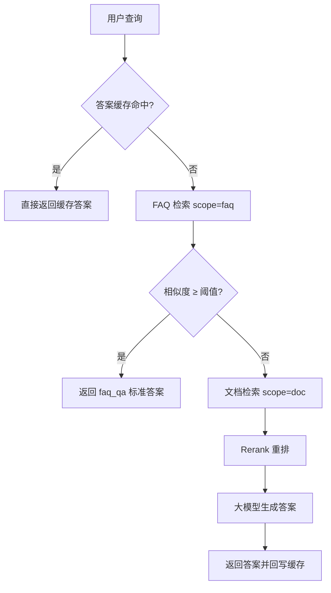
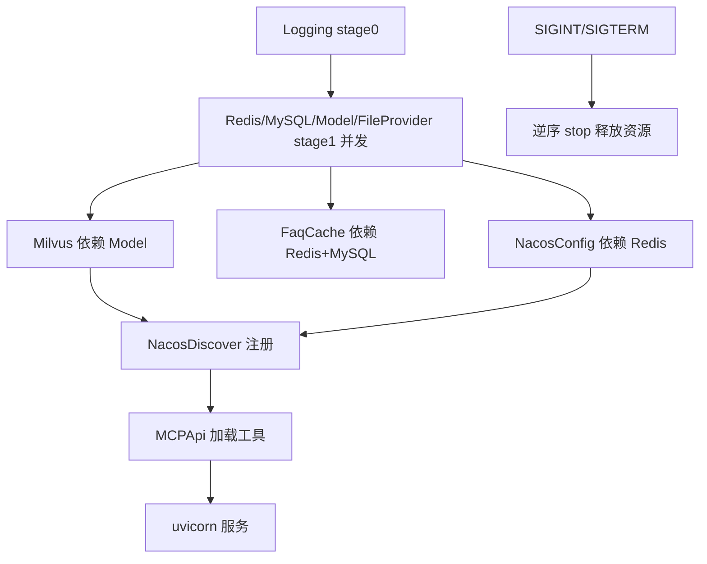

# RAG-Ultra

多租户问答服务，FAQ 优先 + RAG 兜底。技术栈：FastAPI + MySQL + Milvus + Redis + Nacos + MCP，按 M1–M9 模块范式组织。

---

## 1. 核心链路

### 1.1 查询主链路（FAQ 优先）



### 1.2 索引链路（写入侧）


### 1.3 启动与关闭

`app/main.py` 经 uvicorn（`factory=True, workers=N`）拉起 `create_app()`，每个 worker 在 lifespan 内独立初始化资源（Windows spawn 安全）。启动按 stage 编排，关闭逆序释放。



---

## 2. 模块总览

| 模块 | 路径 | 职责 |
|---|---|---|
| M1 接入层 | `app/api` `app/main.py` `app/server.py` | 路由 / 鉴权 / 多租户 / trace / 统一响应 / Manager 编排 |
| M2 索引链路 | `core/rag_indexer` | 文档获取 → 解析 → 清洗 → 分块 → 向量化 → 落库 |
| M3 存储 | `store` | MySQL 元数据 / Milvus 向量 / Redis 缓存·会话 |
| M4 检索 | `core/rag_retriever` | 两路混合召回 + RRF 融合 + Rerank |
| M5 模型 | `core/rag_model` | bge-m3（dense+sparse）/ bge-reranker 封装 |
| M6 评测运维 | （预留） | RAGAS / 灰度 / 双集合切换 |
| M7 运营后台 | `app/api/dashboard` | 文档 / FAQ / 文件 / 配置中心 / 检索调试 / 健康 |
| M8 生成 | `core/rag_generator` | LangChain LCEL 组装检索结果 → LLM |
| M9 路由 | `core/qa_router` | FAQ 优先 + 阈值路由 + RAG 兜底 |

---

## 3. 目录结构

```
RAG-Ultra/
├── app/                          # M1 接入 + 启动骨架
│   ├── main.py                  # 入口：开发(main_dev)/生产(main via run.py)
│   ├── app_factory.py           # FastAPI 工厂：注册 Manager + configure_routes + lifespan
│   ├── app_state.py             # 全局单例 + contextvars（tenant/user/trace）
│   ├── server.py                # AppServer + Manager 启动骨架（stage 编排）
│   ├── middleware.py            # AuthSignature / ApiLog / Trace 中间件
│   ├── managers/                # 启动项：Logging/Redis/MySQL/Model/FileProvider/Milvus/
│   │                           #        FaqCache/NacosConfig/NacosDiscover/MCPApi
│   └── api/
│       ├── deps.py             # resolve_tenant 身份解析依赖
│       ├── schemas/            # 请求/响应契约
│       ├── user/               # 终端用户侧：qa / session
│       └── dashboard/          # 运营后台：health/doc/faq/file/config_read/
│                               #        config_write/retrieve
├── core/                        # M2~M9 核心逻辑
│   ├── rag_indexer/            # 加载→解析→清洗→分块→向量化→落库
│   ├── rag_retriever/          # 两路混合召回 + RRF + Rerank
│   ├── rag_model/              # bge-m3 / bge-reranker 封装
│   ├── rag_generator/          # LangChain LCEL 生成
│   ├── qa_router/              # FAQ 优先路由
│   ├── config_center/          # Nacos 配置中心客户端（v3 OpenAPI + v2.nacos gRPC）
│   ├── auth/                   # HMAC 签名生成/校验
│   ├── session/ session_memory/ intent/ file_provider/ utils/
├── store/                       # M3 存储
│   ├── orm_models/             # MySQL 元数据 ORM
│   ├── mysql_store.py redis_store.py milvus_store.py
│   ├── *_dao.py                # doc/faq/file/session/api_log/health 数据访问
│   └── redis_keys.py           # Redis key / TTL 集中管理
├── common/                      # config.py / logger.py / response.py
├── docs/                        # 架构/部署/鉴权/配置中心 设计文档
├── scripts/                     # gen_schema.py / gen_auth_headers.py
├── docker/ tests/ offline/
├── models/                      # 模型权重（bge-m3 / bge-reranker），gitignore
├── requirements.txt
└── run.py                       # 生产入口（多 worker）
```

---

## 4. 启动与配置

```bash
# 1. 中间件
docker compose -f docker/docker-compose.yml up -d

# 2. 建表
mysql -h127.0.0.1 -uroot -proot rag_ultra < scripts/schema.sql

# 3. 依赖
pip install -r requirements.txt

# 4. 模型权重（bge-m3 / bge-reranker-v2-m3 放 models/BAAI/ 下）

# 5. .env（配置项定义见 common/config.py）

# 6. 启动
python -m app.main   # 开发：单 worker + 热重载
python run.py        # 生产：uvicorn 多 worker（WORKERS），仅 app（8800）
# 基础设施 MCP 不走项目启动器，单独启动：
#   python mcp_demo/server.py --transport sse --host 127.0.0.1 --port 8765
```

关键配置项：

| 项 | 默认 | 说明 |
|---|---|---|
| `HOST` / `PORT` | `127.0.0.1` / `8800` | 业务 HTTP 端口 |
| `WORKERS` | `1` | uvicorn 多进程数 |
| `OPENAPI_ENABLED` | `False` | `/docs` `/redoc` `/openapi.json` |
| `NACOS_ENABLED` / `NACOS_CONFIG_ENABLED` | `True` / `True` | 服务发现 / 配置中心 |
| `MCP_API_ENABLED` | `True` | 业务 API 封装为 MCP 工具（8766） |
| `AUTH_HMAC_ENABLED` | `True` | 调用方 HMAC 签名校验（见 §5.3） |
| `IDENTITY_DEFAULT_ENABLED` | `True` | 缺身份头兜底默认租户/用户（见 §5.2） |
| `API_LOG_ENABLED` / `API_LOG_DB` | `True` / `True` | API 调用日志（中间件 + 落库） |

---

## 5. 接入层

### 5.1 中间件链

请求进入顺序（外→内）：`CORS → Trace → ApiLog → Auth → 路由`。Auth 置于最内层，验签失败仍由 Trace/ApiLog 记录，便于审计被拒调用。

- **TraceMiddleware**：缺失 `X-Trace-Id` 则生成，响应头回写（全链路透传）。
- **ApiLogMiddleware**：记录请求（方法/路径/身份头脱敏/query/body）+ 响应（状态/耗时/body），按 `API_LOG_EXCLUDE` 跳过探活等高噪路径；`API_LOG_DB=True` 时落 `rag_api_call_log`（一条请求一行）。底层纯 ASGI，不吃请求体，故流式响应与大文件上传不受影响。
- **AuthSignatureMiddleware**：见 §5.3。

### 5.2 多租户与身份

租户隔离基于 `X-Tenant-Id`（整数），会话级隔离基于 `X-User-Id`。`resolve_tenant` 依赖写入 `app_state` 的 contextvars：

- 有头：解析 `X-Tenant-Id`（非整数 → 400）；`X-User-Id` 缺失则按 `IDENTITY_DEFAULT_ENABLED` 处理。
- 未接网关自测（`IDENTITY_DEFAULT_ENABLED=True`）：缺头兜底 `DEFAULT_TENANT_ID=100` / `DEFAULT_USER_ID=1001`，日志与落库同步兜底值。
- 网关接入后设 `IDENTITY_DEFAULT_ENABLED=False`：缺头即拒（401），避免漏传头时静默落到默认租户。

### 5.3 调用方签名校验

防"绕过网关直连、伪造 `X-Tenant-Id`/`X-User-Id`"。实现在 `core/auth`：

```
canonical = METHOD \n PATH \n TIMESTAMP \n NONCE \n TENANT \n USER
signature = HMAC-SHA256(secret, canonical)        # 64 位 hex，小写比对
```

`AuthSignatureMiddleware` 在路由前完成：头齐全 → 时间戳为秒级整数 → `|now - ts| ≤ AUTH_HMAC_TTL`（±窗口，防过期/未来）→ HMAC 匹配（当前或 `AUTH_HMAC_SECRET_PREV` 密钥任一）→ nonce 经 Redis `SETNX` 去重（防重放）。任一失败返回 401（`code=40100`）。排除路径见 `AUTH_HMAC_EXCLUDE`。

签名头生成：`scripts/gen_auth_headers.py`（参数取 `common/config.py` 默认，可直接运行或命令行传参），面向本地/联调自测，生成 `X-Auth-Timestamp` / `X-Auth-Nonce` / `X-Auth-Signature` 与可直接执行的 curl。

> 当前为"信任头"模型（Model A）。HMAC 仅加固防直连；强校验需网关侧 strip 同名头再注入 + 后端网络不对外直达。MCP 工具经进程内 ASGI 调用业务 API，复用同一套中间件，无需在 MCP 侧重复实现。

### 5.4 统一响应与错误码

```json
{"code": 0, "msg": "", "data": {}}
```

| code | 含义 |
|---|---|
| `0` | 成功 |
| `40001` | `MISSING_TENANT`（缺 `X-Tenant-Id`） |
| `40100` | `UNAUTHORIZED`（签名缺失/过期/不匹配/nonce 重放） |

---

## 6. API 路由

按调用方分包隔离：`app.api.user`（终端用户：问答/会话）与 `app.api.dashboard`（运营后台：文档/FAQ/文件/配置/检索调试/健康）。

| Method | Path | 说明 |
|---|---|---|
| POST | `/v1/chat` | 对话主入口（SSE 流式）：FAQ 优先 + RAG 兜底 |
| POST | `/v1/retrieve` | 底层混合检索（scope=doc/faq） |
| POST | `/v1/sessions/{id}/turns` | 多轮会话写入 |
| GET | `/v1/sessions/{id}` | 读取会话历史 |
| POST | `/v1/files/upload` | 文件上传（oss_key + version + expires_at） |
| GET | `/v1/files/{oss_key}` | 取文件（?base64=true 直出） |
| POST | `/v1/docs` | 建 doc + 触发索引 |
| POST | `/v1/faq` | 新建 FAQ（触发入库） |
| GET | `/admin/health` | 健康检查（7 项，供 Nacos 探活） |

配置中心代理（读/写/历史/回滚）由 `dashboard` 的 config 路由提供，后端对 Nacos 的写操作均经审批流（`core/config_center/service`）。

### 健康检查

`/admin/health` 返回 7 项状态（均取自内存/连接探测，不发额外网络请求以免被探活刷表）：

```
status / redis / mysql / milvus / model / mcp / nacos / config_center
```

`mcp` = 业务 API MCP 工具已加载；`nacos` = 实例注册成功（`NACOS_DISCOVER_STRICT` 决定失败是否阻断启动）；`config_center` = 配置中心长连接已建立。未启用/未就绪为 `False`，不影响 `status`。

---

## 7. MCP 服务

两套独立 MCP，传输方式不同：

1. **基础设施 MCP**（`mcp_demo/server.py`）：mysql/redis 等运维工具，SSE，`127.0.0.1:8765`。不随项目启动器拉起，按 `python mcp_demo/server.py --transport sse --host 127.0.0.1 --port 8765` 单独启动。
2. **业务 API MCP**（`app/managers/mcp_api_manager.py`）：把 app 全部 HTTP API 封装为 MCP 工具（当前 36 个），`streamable-http`，`127.0.0.1:8766`。`collect_routes` 递归展开 `include_router`（FastAPI 0.143+ 的惰性 `_IncludedRouter`）并拼接前缀；`MCP_API_EXCLUDE` 屏蔽文档/探活等路径。

---

## 8. Nacos 集成

服务端为 **3.2.x**，依赖 `nacos-sdk-python>=2`（v2.nacos，全异步 gRPC）。

### 8.1 服务发现

`NacosDiscoverManager`：用 `NacosNamingService` 注册 `SERVICE_NAME@SERVICE_IP:PORT`（ephemeral），心跳由 SDK 长连接维持，无自建心跳循环。`NACOS_DISCOVER_STRICT=True` 时注册失败 fail-fast，否则告警继续。`/admin/health` 作为探活端点。

### 8.2 配置中心

`NacosConfigManager` 在启动期拉起 `ConfigCenterLoader`（v2.nacos `NacosConfigService`，gRPC 长连接 + 监听回调），注入 `app_state` 供健康检查。`core/config_center/nacos_config.py` 走 v3 OpenAPI 做读/发布/回滚代理：

- 读：配置/历史/命名空间列表（v3 `/admin/cs/...`、`/admin/core/namespace/list`）。
- 回滚：3.x 已移除 rollback 端点，改为"按 `nid` 取历史内容 + `publish_config` 重发"。
- 命名空间：3.x 要求 UUID；`common/nacos_compat.resolve_namespace_id` 把显示名（如 `rag-ultra`）解析为 UUID，`public` 映射空串。

---

## 9. 存储层

- **MySQL**（`store/orm_models` + `mysql_store.py`）：元数据 ORM（租户/知识库/文档/FAQ/会话等），异步 SQLAlchemy 会话池。
- **Milvus**（`milvus_store.py`）：`rag_chunks` 集合，dense cosine + sparse IP 双向量，partition key 做租户隔离。
- **Redis**（`redis_store.py` + `redis_keys.py`）：答案/embedding/prompt/faq 缓存、会话原文与记忆、限流令牌桶、聊天停止标记、签名 nonce 去重。key 前缀与 TTL 集中在 `redis_keys.py`，禁止散落硬编码。

---

## 10. 待开发（TODO）

按优先级：

- 异步索引 Worker（Celery/ARQ 投递与幂等状态机）
- FAQ/文档索引落库业务实现（当前部分路由为占位）
- MinIO/OSS FileProvider 实装、分布式锁、限流令牌桶细化
- M6 评测 / 灰度
- M7 控制台前端
