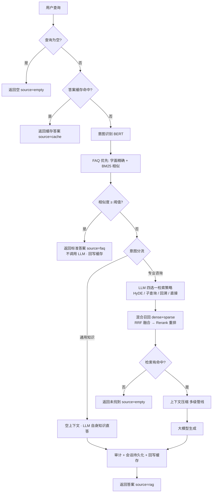
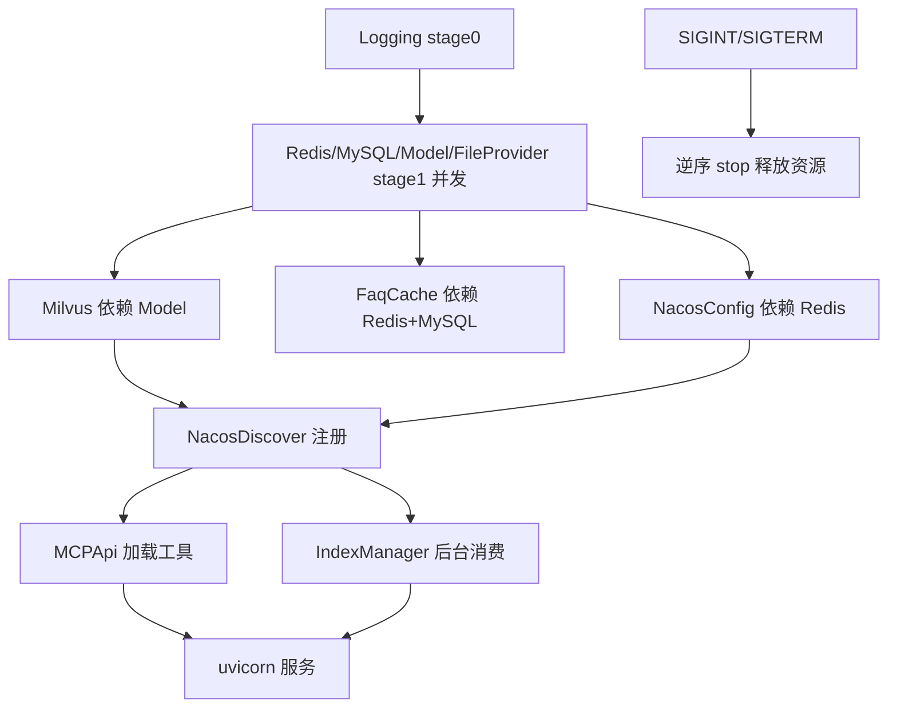

# 多租户的企业级检索增强问答（RAG）中台

> **定位**：面向多租户的企业级检索增强问答（RAG）中台，解决企业级文档管理与检索困难——让"资料存得下、找不到、不敢用"变成"问一句就得到带出处的答案"。
>
> 以"**FAQ 优先 + RAG 兜底**"双通道为核心，把散落的企业文档和口口相传的经验变成可溯源、可审计、可运营的知识服务，并在检索、生成、会话、治理四个层面完成工程化落地。
>
> 技术栈：FastAPI + MySQL + Milvus + Redis + Nacos + MCP。

---

## 1. 为什么要做这个项目（背景与痛点）

### 1.1 现状：过去是怎么找资料的

企业一线员工要拿到一个准确答案，靠的往往不是系统，而是"问人"和"翻文档"。

问人是常态。遇到问题时，习惯在工位上喊一嗓子、在群里 @ 老员工——"这个之前谁处理过""上次是怎么定的"。答案靠经验和记忆传递，人一走就断。

翻文档是兜底。共享盘、邮件附件、本地文件夹里翻 PDF、Word 和扫描件，手册动辄几百上千页，定位一个条款要十几分钟。营业高峰或检修窗口这种争分夺秒的场景，根本等不起。

问题是即便翻到了也不一定敢用。同一个问题问三个人可能有三种说法，谁对全凭资历；真出了事，谁也拿不出"当时依据的是哪份文件"。

一句话：资料存得下，却找不到；找到了，也不敢确定是不是现行有效版本。

### 1.2 核心痛点：企业级文档管理与检索困难

这些表象背后是同一个问题：企业缺少对文档的统一管理和有效检索。

资料分散在各处。PLM、OA、共享盘、邮件、聊天记录里都有，格式从 PDF、Word、PPT 到表格、扫描件不等，始终没有一个统一的检索入口。

存得下但找不到。关键词检索搜不到语义相关的内容，按文件名更不可能定位到内容里的条款。

版本说不清。同一份资料常有多个版本和替代关系，一线分不清哪份是现行有效，按旧版执行直接导致返工。

经验跟着人走。口口相传的东西留不下来，人员一流动就断层，新人上手周期被拉长。

口径对不齐。同一个问题不同人给出的答案不同，对外或合规场景没法保证统一口径。

依据拿不出。给出答案却没有出处，出问题难定责；文档变更也没留痕、不可回滚。

### 1.3 为什么不是"直接接一个大模型"

把文档丢给通用大模型，看起来能解决，落到生产会碰到三个断层。

检索上，纯语义向量对型号、条款号、报警码、专有名词这类需要字面精确的查询会失效；用户口语化的提问和文档书面术语对不上，又会漏召回。

生成上，所有问题无差别调用 LLM，成本和延迟都压不住；而且模型改写会让同一问题在不同时间给出不同表述，合规场景不能用。

工程上，缺租户隔离、配置治理、审计留痕和优雅降级，进不了生产。

所以中台的定位是：不只做检索加生成，而是把散落文档和经验统一纳管，让员工问一句就能拿到带出处的答案，同时把多租户隔离、混合检索、成本分层、多轮记忆、配置审批流、全链路审计和启动编排补齐，让它具备进生产的条件。

### 1.4 关键设计取舍

字面精确查询失效、口语与书面术语对不上，用混合检索解决：bge-m3 同时产出 dense 和 sparse 双向量，RRF 融合后用 bge-reranker 交叉编码重排，再配合语义父块与递归子块两级切分，兼顾语义完整性和检索粒度。

文档分散、没有统一入口，就建统一索引链路：多格式加载 → 父子块切分 → 向量化 → Milvus 双向量落库。

版本混乱，做文件多版本治理：内容哈希去重、版本历史、幂等上传，回答里标注所依据的版本和生效日期。

经验留不下来、口径对不齐，靠 FAQ 优先：高频问题命中标准答案后直接返回权威原文，不调 LLM，成本为零且口径统一，长尾才走检索增强生成。

拿不出依据，就让回答带上 `doc_name / page` 出处，再用 trace_id 全链路透传、API 日志落库和问答明细异步持久化，形成可举证的档案。

长文档超上下文窗口，做多级压缩：先按 rerank 分数按大小截取，再做相关性精选，必要时才用 LLM 摘要合并，全程保留溯源，异常时回退原样。

多轮追问跨窗口断片，靠会话和记忆补：Redis 存原文并设 TTL，MySQL 存注册表支持长期回看，记忆每 4 轮 compaction 生成 `summary` 和 `facts` 注入生成上下文。

租户要隔离、配置变更要能回滚，就做三层隔离（Milvus partition key、Redis key 前缀、MySQL `tenant_id`），提示词和检索阈值托管到 Nacos，写操作一律走申请、复核、执行、回滚的审批流。

接口可能被绕过网关直连、伪造身份头或重放，用 HMAC-SHA256 签名加 nonce 防重放、时间戳窗口防过期。

模型、向量库、配置中心任一异常就可能拖垮启动，所以启动按 stage 编排，stage 内并发、stage 间按依赖有序，单组件失败只降级不阻断，`/admin/health` 供 Nacos 探活摘除故障实例。

---

## 2. 核心链路

### 2.1 查询主链路（FAQ 优先 + 意图分流）



> `source` 取值：`cache` / `faq` / `rag` / `empty`。`answer` 与 `answer_stream`（SSE 流式）共用同一链路。

### 2.2 索引链路（写入侧）


> 子块 metadata 保留 `parent_id` / `parent_content`，检索时可回退到父块上下文；`chunk_id` 由 `(tenant_id, doc_id, parent_id, seq)` 稳定生成，保证 Milvus upsert 幂等覆盖。

### 2.3 启动与关闭

`app/main.py` 经 uvicorn（`factory=True, workers=N`）拉起 `create_app()`，每个 worker 在 lifespan 内独立初始化资源（Windows spawn 安全）。启动按 stage 编排（stage 内 `asyncio.gather` 并发、stage 间按依赖有序），关闭逆序释放。



> 任一 Manager 启动失败即记"启动失败"；非关键组件（如意图分类模型缺失）支持优雅降级，不阻断整体启动。

---

## 3. 模块总览

| 模块 | 路径 | 职责 |
|---|---|---|
| 接入层 | `app/api` `app/main.py` `app/server.py` | 路由 / 鉴权 / 多租户 / trace / 统一响应 / Manager 编排 |
| 索引链路 | `core/rag_indexer` | 文档获取 → 解析 → 父子块切分 → 向量化 → 落库（MySQL + Milvus） |
| 存储 | `store` | MySQL 元数据 / Milvus 向量 / Redis 缓存·会话 |
| 检索 | `core/rag_retriever` | 两路混合召回 + RRF 融合 + Rerank |
| 模型 | `core/rag_model` | bge-m3（dense+sparse）/ bge-reranker 封装 |
| 评测运维 | （预留） | RAGAS 评测（LLM 结果审计，规划中）/ 灰度 / 双集合切换 |
| 运营后台 | `app/api/dashboard` | 文档 / FAQ / 文件 / 配置中心 / 检索调试 / 健康 |
| 生成 | `core/rag_generator` | LangChain LCEL 组装检索结果 → LLM |
| 路由 | `core/qa_router` | FAQ 优先 + 意图分流 + 阈值路由 + RAG 兜底 |

---

## 4. 目录结构

```
RAG-Ultra/
├── app/                          # 接入层 + 启动骨架
│   ├── main.py                  # 入口：开发(main_dev)/生产(main via run.py)
│   ├── app_factory.py           # FastAPI 工厂：注册 Manager + configure_routes + lifespan
│   ├── app_state.py             # 全局单例 + contextvars（tenant/user/trace）
│   ├── server.py                # AppServer + Manager 启动骨架（stage 编排）
│   ├── middleware.py            # AuthSignature / ApiLog / Trace 中间件
│   ├── managers/                # 启动项：Logging/Redis/MySQL/Model/FileProvider/Milvus/
│   │                           #        FaqCache/Index/NacosConfig/NacosDiscover/MCPApi
│   └── api/
│       ├── deps.py             # resolve_tenant 身份解析依赖
│       ├── schemas/            # 请求/响应契约
│       ├── user/               # 终端用户侧：qa / session
│       └── dashboard/          # 运营后台：health/doc/faq/file/config_read/
│                               #        config_write/retrieve
├── core/                        # 核心业务逻辑
│   ├── rag_indexer/            # 加载→解析→父子块切分→向量化→落库
│   ├── rag_retriever/          # 两路混合召回 + RRF + Rerank
│   ├── rag_model/              # bge-m3 / bge-reranker 封装
│   ├── rag_generator/          # LangChain LCEL 生成
│   ├── qa_router/              # FAQ 优先 + 意图分流路由
│   ├── config_center/          # Nacos 配置中心客户端（v3 OpenAPI + v2.nacos gRPC）
│   ├── auth/                   # HMAC 签名生成/校验
│   ├── session/ session_memory/ intent/ file_provider/ utils/
├── store/                       # 存储层
│   ├── orm_models/             # MySQL 元数据 ORM
│   ├── mysql_store.py redis_store.py milvus_store.py memory_store.py faq_cache.py
│   ├── *_dao.py                # doc/faq/file/session/api_log/health 数据访问
│   └── redis_keys.py           # Redis key / TTL 集中管理
├── common/                      # config.py / logger.py / response.py
├── dashboard/                   # (预留) 控制台前端（当前为空目录）
├── docs/                        # 架构/部署/鉴权/配置中心/设计方案 文档
├── scripts/                     # gen_schema.py / gen_auth_headers.py
├── docker/ tests/ offline/
├── models/                      # 模型权重（bge-m3 / bge-reranker），gitignore
├── requirements.txt
└── run.py                       # 生产入口（多 worker）
```

---

## 5. 启动与配置

```bash
# 1. 中间件
docker compose -f docker/docker-compose.yml up -d

# 2. 建表
mysql -h127.0.0.1 -uroot -proot rag_ultra < scripts/schema.sql

# 3. 依赖
pip install -r requirements.txt

# 4. 模型权重（bge-m3 / bge-reranker-v2-m3 放 models/BAAI/ 下）

# 5. .env（配置项定义见 common/config.py）

# 6. 启动
python -m app.main   # 开发：单 worker + 热重载
python run.py        # 生产：uvicorn 多 worker（WORKERS），仅 app（8800）
# 业务 API MCP 由 MCPApiManager（启动 stage 3）在 MCP_API_ENABLED=True 时随应用拉起，无需单独启动
```

关键配置项：

| 项 | 默认 | 说明 |
|---|---|---|
| `HOST` / `PORT` | `127.0.0.1` / `8800` | 业务 HTTP 端口 |
| `WORKERS` | `1` | uvicorn 多进程数 |
| `OPENAPI_ENABLED` | `False` | `/docs` `/redoc` `/openapi.json` |
| `NACOS_ENABLED` / `NACOS_CONFIG_ENABLED` | `True` / `True` | 服务发现 / 配置中心 |
| `MCP_API_ENABLED` | `True` | 业务 API 封装为 MCP 工具（streamable-http） |
| `MCP_API_HOST` / `MCP_API_PORT` | `127.0.0.1` / `8766` | 业务 API MCP 服务地址 |
| `AUTH_HMAC_ENABLED` | `True` | 调用方 HMAC 签名校验（见 §6.3） |
| `IDENTITY_DEFAULT_ENABLED` | `True` | 缺身份头兜底默认租户/用户（见 §6.2） |
| `API_LOG_ENABLED` / `API_LOG_DB` | `True` / `True` | API 调用日志（中间件 + 落库） |

---

## 6. 接入层

### 6.1 中间件链

请求进入顺序（外→内）：`CORS → Trace → ApiLog → Auth → 路由`。Auth 置于最内层，验签失败仍由 Trace/ApiLog 记录，便于审计被拒调用。

- **TraceMiddleware**：缺失 `X-Trace-Id` 则生成，响应头回写（全链路透传）。
- **ApiLogMiddleware**：记录请求（方法/路径/身份头脱敏/query/body）+ 响应（状态/耗时/body），按 `API_LOG_EXCLUDE` 跳过探活等高噪路径；`API_LOG_DB=True` 时落 `rag_api_call_log`（一条请求一行）。底层纯 ASGI，不吃请求体，故流式响应与大文件上传不受影响。
- **AuthSignatureMiddleware**：见 §6.3。

### 6.2 多租户与身份

租户隔离基于 `X-Tenant-Id`（整数），会话级隔离基于 `X-User-Id`。`resolve_tenant` 依赖写入 `app_state` 的 contextvars：

- 有头：解析 `X-Tenant-Id`（非整数 → 400）；`X-User-Id` 缺失则按 `IDENTITY_DEFAULT_ENABLED` 处理。
- 未接网关自测（`IDENTITY_DEFAULT_ENABLED=True`）：缺头兜底 `DEFAULT_TENANT_ID=100` / `DEFAULT_USER_ID=1001`，日志与落库同步兜底值。
- 网关接入后设 `IDENTITY_DEFAULT_ENABLED=False`：缺头即拒（401），避免漏传头时静默落到默认租户。

三层存储隔离：Milvus **partition key**、Redis **key 前缀**、MySQL **`tenant_id`**；用户级再叠 `X-User-Id` 隔离会话。

### 6.3 调用方签名校验

防"绕过网关直连、伪造 `X-Tenant-Id`/`X-User-Id`"。实现在 `core/auth`：

```
canonical = METHOD \n PATH \n TIMESTAMP \n NONCE \n TENANT \n USER
signature = HMAC-SHA256(secret, canonical)        # 64 位 hex，小写比对
```

`AuthSignatureMiddleware` 在路由前完成：头齐全 → 时间戳为秒级整数 → `|now - ts| ≤ AUTH_HMAC_TTL`（±窗口，防过期/未来）→ HMAC 匹配（当前或 `AUTH_HMAC_SECRET_PREV` 密钥任一）→ nonce 经 Redis `SETNX` 去重（防重放）。任一失败返回 401（`code=40100`）。排除路径见 `AUTH_HMAC_EXCLUDE`。

签名头生成：`scripts/gen_auth_headers.py`（参数取 `common/config.py` 默认，可直接运行或命令行传参），面向本地/联调自测，生成 `X-Auth-Timestamp` / `X-Auth-Nonce` / `X-Auth-Signature` 与可直接执行的 curl。

> 当前为"信任头"模型。HMAC 仅加固防直连；强校验需网关侧 strip 同名头再注入 + 后端网络不对外直达。MCP 工具经进程内 ASGI 调用业务 API，复用同一套中间件。

### 6.4 统一响应与错误码

```json
{"code": 0, "msg": "", "data": {}}
```

| code | 含义 |
|---|---|
| `0` | 成功 |
| `40001` | `MISSING_TENANT`（缺 `X-Tenant-Id`） |
| `40100` | `UNAUTHORIZED`（签名缺失/过期/不匹配/nonce 重放） |

---

## 7. API 路由

按调用方分包隔离：`app/api/user`（终端用户：问答/会话）与 `app/api/dashboard`（运营后台：文档/FAQ/文件/配置/检索调试/健康）。用户侧统一前缀 `/v1`，运营后台统一前缀 `/admin`（配置相关再挂 `/admin/config`）。

### 7.1 终端用户（`app/api/user`，前缀 `/v1`）

| Method | Path | 说明 |
|---|---|---|
| POST | `/v1/chat` | 对话主入口（SSE 流式）：FAQ 优先 + 意图分流 + RAG 兜底 |
| POST | `/v1/chat/stop` | 停止当前会话的流式生成（幂等） |
| DELETE | `/v1/chat/context/{session_id}` | 删除当前会话窗口记忆（压缩上下文，不影响历史） |
| POST | `/v1/sessions` | 创建会话（返回 session_id + 标题） |
| GET | `/v1/sessions` | 会话列表（读 MySQL 注册表） |
| POST | `/v1/sessions/{session_id}/turns` | 追加一轮对话（首轮自动生成标题） |
| GET | `/v1/sessions/{session_id}` | 会话详情（标题 + 原文 + 记忆） |
| PATCH | `/v1/sessions/{session_id}` | 更新会话标题 |
| DELETE | `/v1/sessions/{session_id}` | 删除会话（清 Redis 原文 + 记忆 + MySQL 注册表） |

### 7.2 运营后台（`app/api/dashboard`，前缀 `/admin`）

| Method | Path | 说明 |
|---|---|---|
| GET | `/admin/health` | 健康检查（探活，供 Nacos） |
| POST | `/admin/retrieve` | 检索调试（SSE 流式，scope=doc/faq） |
| POST | `/admin/files/upload` | 上传文件（单发，幂等，多版本） |
| POST | `/admin/files/batch-upload` | 批量上传文件 |
| GET | `/admin/files` | 文档列表 |
| GET | `/admin/files/{base_key}/versions` | 文档版本历史 |
| GET | `/admin/files/{oss_key:path}` | 下载文件（原始字节流，带租户校验） |
| POST | `/admin/files/batch` | 批量下载（base64，小文件） |
| DELETE | `/admin/files/{base_key}` | 删除文档（软删除） |
| POST | `/admin/faq` | 新建 FAQ（触发入库） |
| PUT | `/admin/faq/{faq_id}` | 更新 FAQ |
| DELETE | `/admin/faq/{faq_id}` | 删除 FAQ（软删除） |
| GET | `/admin/faq/{faq_id}` | 查看单条 FAQ |
| GET | `/admin/faq` | FAQ 列表 |
| POST | `/admin/docs` | 创建文档索引 |
| GET | `/admin/docs/{doc_id}/status` | 查询文档索引状态 |
| GET | `/admin/config/namespaces` | Nacos 命名空间列表 |
| GET | `/admin/config/list` | 配置列表 |
| GET | `/admin/config/detail` | 配置详情（当前内容） |
| GET | `/admin/config/history` | 配置历史版本列表 |
| GET | `/admin/config/history/{nid}` | 配置历史版本详情 |
| POST | `/admin/config/requests` | 提交配置变更申请 |
| GET | `/admin/config/requests` | 变更申请列表 |
| GET | `/admin/config/requests/{request_id}` | 变更申请详情 |
| POST | `/admin/config/requests/{request_id}/review` | 复核变更申请 |
| POST | `/admin/config/requests/{request_id}/execute` | 执行变更（写 Nacos） |
| POST | `/admin/config/rollback` | 提交回滚申请 |
| POST | `/admin/config/requests/{request_id}/sync-history` | 补偿同步历史 nid |

配置中心代理（读/写/历史/回滚）由 `dashboard` 的 config 路由提供，后端对 Nacos 的写操作均经审批流（`core/config_center/service`），不直连写 Nacos。

### 健康检查

`/admin/health` 返回 `status` 与 7 项组件状态（均取自内存/连接探测，不发额外网络请求以免被探活刷表）：

```
redis / mysql / milvus / model / mcp / nacos / config_center
```

`mcp` = 业务 API MCP 工具已加载（`app_state.mcp_server` 非空）；`nacos` = 实例注册成功（`NACOS_DISCOVER_STRICT` 决定失败是否阻断启动）；`config_center` = 配置中心长连接已建立。未启用/未就绪为 `False`，不影响 `status`。

---

## 8. MCP 服务（业务 API MCP）

**业务 API MCP**（`app/managers/mcp_api_manager.py`）：把 app 全部 HTTP API 自动封装为 MCP 工具（数量随路由变动），传输协议 `streamable-http`，默认 `127.0.0.1:8766`（由 `MCP_API_HOST` / `MCP_API_PORT` 配置）。由 `MCPApiManager`（启动 stage 3）在 `MCP_API_ENABLED=True` 时随应用拉起，无需单独启动。`collect_routes` 递归展开 `include_router` 并拼接前缀；`MCP_API_EXCLUDE` 屏蔽文档/探活等路径。

工具经进程内 ASGI 调用业务 API，复用 §6.3 同一套中间件（含 HMAC 签名校验）。

---

## 9. Nacos 集成

服务端为 **3.2.x**，依赖 `nacos-sdk-python>=2`（v2.nacos，全异步 gRPC）。

### 9.1 服务发现

`NacosDiscoverManager`：用 `NacosNamingService` 注册 `SERVICE_NAME@SERVICE_IP:PORT`（ephemeral），心跳由 SDK 长连接维持，无自建心跳循环。`NACOS_DISCOVER_STRICT=True` 时注册失败 fail-fast，否则告警继续。`/admin/health` 作为探活端点。

### 9.2 配置中心

`NacosConfigManager` 在启动期拉起 `ConfigCenterLoader`（v2.nacos `NacosConfigService`，gRPC 长连接 + 监听回调），注入 `app_state` 供健康检查。`core/config_center/nacos_config.py` 走 v3 OpenAPI 做读/发布/回滚代理：

- 读：配置/历史/命名空间列表（v3 `/admin/cs/...`、`/admin/core/namespace/list`）。
- 回滚：3.x 已移除 rollback 端点，改为"按 `nid` 取历史内容 + `publish_config` 重发"。
- 命名空间：3.x 要求 UUID；`common/nacos_compat.resolve_namespace_id` 把显示名（如 `rag-ultra`）解析为 UUID，`public` 映射空串。

---

## 10. 存储层

- **MySQL**（`store/orm_models` + `mysql_store.py`）：元数据 ORM（租户/知识库/文档/FAQ/会话等），异步 SQLAlchemy 会话池。
- **Milvus**（`milvus_store.py`）：`rag_chunks` 集合，dense cosine + sparse IP 双向量，partition key 做租户隔离。
- **Redis**（`redis_store.py` + `redis_keys.py`）：答案/embedding/prompt/faq 缓存、会话原文与记忆、限流令牌桶、聊天停止标记、签名 nonce 去重。key 前缀与 TTL 集中在 `redis_keys.py`，禁止散落硬编码。

---

## 11. 未实现 / 待落地（TODO）

> 以下能力调用点已打通、但实现为 no-op / 原样返回（当前不会抛错、不影响主链路），尚未真正落地。

### 11.1 问答编排占位能力（`core/qa_router/router.py`）

| 能力 | 当前状态 | 落地依据 |
|---|---|---|
| **上下文压缩** `_compress_context` | 已落地 | 按大小（字符数）配置，L0 截取 → L1 相关性精选 → L2 LLM 摘要（默认关）；按句截断、保留溯源、失败回退原样。方案见 `docs/上下文压缩设计方案.md` |
| **会话记录持久化** `_persist_session` | 已落地 | 一轮两条（user/assistant）写 Redis 会话原文 + MySQL `rag_turn`，异步不阻塞主链路、失败降级；覆盖 cache/faq/rag/empty 全部出口。方案见 `docs/会话记录持久化设计方案.md` |
| **LLM 结果审计** `_audit_llm_result` | no-op，仅打日志 | 后续接入 **RAGAS** 评测管道统一落地，不在业务库做质量评估计算与持久化 |

### 11.2 平台能力

- 异步索引 Worker（Celery/ARQ 投递与幂等状态机）
- FAQ/文档索引落库业务实现（当前部分路由为占位）
- MinIO/OSS FileProvider 实装、分布式锁、限流令牌桶细化
- 评测 / 灰度（与 11.1 的 RAGAS 审计衔接）
- 控制台前端（`dashboard/` 当前为空目录）
